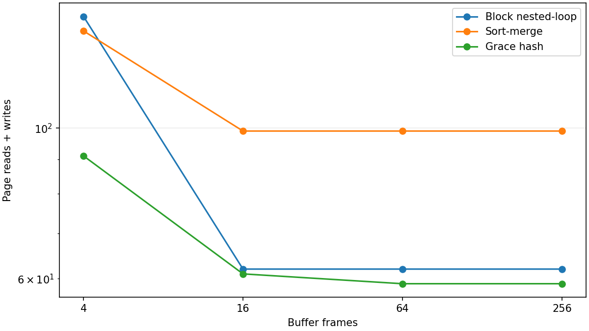
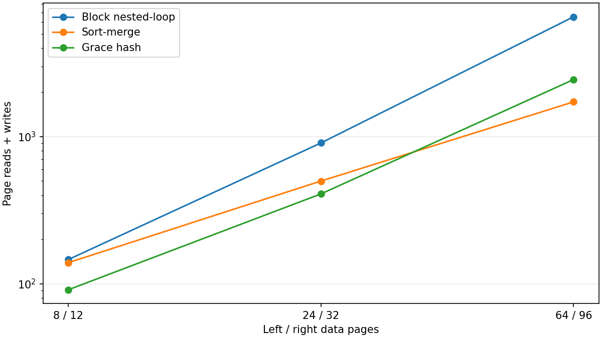

# Module 2 report

The instructor approved self-generated inputs. Reproduce the sort
measurements with `python measure_m2_sort.py`. Reproduce the join
measurements with `python measure_m2_joins.py > m2_join_measurements.json`.
With matplotlib installed, `python plot_m2_joins.py` regenerates the plots.

## Sort passes and execution I/O

Each input record is a valid 4084-byte encoded tuple, so every input
data page holds one record. The key order is descending in storage
and the query sorts it ascending. Every run uses a cold pool.

| Input pages N | Frames B | Initial runs | Formula passes | Measured passes | Reads | Writes | Peak accounted frames |
|---|---|---|---|---|---|---|---|
| 1 | 4 | 1 | 1 | 1 | 3 | 1 | 4 |
| 4 | 4 | 1 | 1 | 2 | 13 | 8 | 4 |
| 8 | 3 | 3 | 3 | 3 | 31 | 22 | 3 |
| 10 | 4 | 3 | 2 | 2 | 31 | 20 | 4 |
| 20 | 8 | 3 | 2 | 2 | 61 | 40 | 8 |
| 33 | 4 | 9 | 3 | 3 | 133 | 99 | 4 |
| 80 | 4 | 20 | 4 | 4 | 393 | 312 | 4 |

Formula passes use 1 + ceil(log(ceil(N/B))/log(B-1)), with one pass
for a nonempty single run. The measured sorting pass count excludes
the separately identified input spool, while the reported I/O includes it.

The N=B=4 case takes an additional streaming pass. All four pages
are sorted as one run, which is then written and released before
one output tuple is decoded. That leaves space for its reserved
workspace. Smaller runs can stream from their pinned input pages.

For N=80 and B=4, the twenty initial runs become seven, then three,
then a streamed final result. The peak logical page allocation is
four frames. This includes streaming tuple workspace, and excludes
Python interpreter and administrative metadata overhead.

All seven cases returned the correct order and row count. All had
zero pinned frames and no surviving temporary files after close.

## Cost of the preparatory spool

For N=8 and B=3, the three sorting phases use 22 reads and 14 writes,
matching the handout's carry-forward variant. The child heap scan
adds nine reads and the unsorted spool adds eight writes, giving
31 reads and 22 writes for the complete query.

For N=80 and B=4, sorting reads 312 pages and the child scan reads
81. Sorting and spooling together write 312 pages. The complete
query therefore records 393 reads and 312 writes. The extra I/O
is the cost of closing the child's working state before using all
B frames for initial run generation.

## Sources

Graefe's iterator model informed the distinction between blocking
work in open and output streaming in next, with recursive cleanup.
[Graefe, Volcano, 1994](https://people.eecs.berkeley.edu/~prabal/teaching/resources/eecs582/graefe94volcano.pdf)

CMU's sorting notes informed run sizing and merge fan-in. They also
provided the baseline against which the extra spool I/O is explained.
[CMU sorting notes](https://15445.courses.cs.cmu.edu/spring2026/notes/11-queryI.pdf)

## Join correctness at four frames

The worked duplicate-key fixture uses one INT column per input.
R contains 1, 2, 2, 3 and S contains 2, 2, 4. Each algorithm emitted
four copies of (2, 2). Block nested-loop evaluated all 12 pairs.

A larger fixture adds five VARCHAR(255) columns to each input and
fills each field to its declared length. All ten left rows and all
thirteen right rows have key 2. All three joins emitted 130 matches.
Hash join used the block nested-loop fallback for the oversized
matching partition. Tests also cover inequality predicates for
block nested-loop, empty input, early LIMIT, and cleanup.

## Join I/O against the formulas

Each input has an INT key, fifteen VARCHAR(255) columns, and one
VARCHAR(223) column. Padding fills every declared length. Each
4084-byte tuple occupies its own data page. The baseline keys on
each side run from 1 through the row count, yielding one match per
key shared by the inputs. Every query starts with a cold buffer
pool. Catalog setup I/O is excluded. Reads and writes include child
execution and temporary files.

| Left pages | Right pages | B | Join | Formula I/O | Measured reads | Measured writes |
|---:|---:|---:|---|---:|---:|---:|
| 8 | 12 | 4 | Grace hash | 60 | 71 | 20 |
| 8 | 12 | 4 | Block nested-loop | 56 | 126 | 20 |
| 8 | 12 | 4 | Sort-merge | 80 | 79 | 60 |
| 8 | 12 | 16 | Grace hash | 60 | 41 | 20 |
| 8 | 12 | 16 | Block nested-loop | 20 | 42 | 20 |
| 8 | 12 | 16 | Sort-merge | 40 | 59 | 40 |
| 8 | 12 | 64 | Grace hash | 60 | 39 | 20 |
| 8 | 12 | 64 | Block nested-loop | 20 | 42 | 20 |
| 8 | 12 | 64 | Sort-merge | 40 | 59 | 40 |
| 8 | 12 | 256 | Grace hash | 60 | 39 | 20 |
| 8 | 12 | 256 | Block nested-loop | 20 | 42 | 20 |
| 8 | 12 | 256 | Sort-merge | 40 | 59 | 40 |
| 24 | 32 | 4 | Grace hash | 168 | 352 | 56 |
| 24 | 32 | 4 | Block nested-loop | 408 | 850 | 56 |
| 24 | 32 | 4 | Sort-merge | 336 | 275 | 224 |
| 24 | 32 | 16 | Grace hash | 168 | 112 | 56 |
| 24 | 32 | 16 | Block nested-loop | 88 | 146 | 56 |
| 24 | 32 | 16 | Sort-merge | 224 | 219 | 168 |
| 24 | 32 | 64 | Grace hash | 168 | 107 | 56 |
| 24 | 32 | 64 | Block nested-loop | 56 | 114 | 56 |
| 24 | 32 | 64 | Sort-merge | 112 | 163 | 112 |
| 24 | 32 | 256 | Grace hash | 168 | 106 | 56 |
| 24 | 32 | 256 | Block nested-loop | 56 | 114 | 56 |
| 24 | 32 | 256 | Sort-merge | 112 | 163 | 112 |
| 64 | 96 | 4 | Grace hash | 480 | 2284 | 160 |
| 64 | 96 | 4 | Block nested-loop | 3136 | 6370 | 160 |
| 64 | 96 | 4 | Sort-merge | 1280 | 927 | 796 |
| 64 | 96 | 16 | Grace hash | 480 | 322 | 160 |
| 64 | 96 | 16 | Block nested-loop | 544 | 706 | 160 |
| 64 | 96 | 16 | Sort-merge | 640 | 611 | 480 |
| 64 | 96 | 64 | Grace hash | 480 | 309 | 160 |
| 64 | 96 | 64 | Block nested-loop | 256 | 418 | 160 |
| 64 | 96 | 64 | Sort-merge | 512 | 611 | 480 |
| 64 | 96 | 256 | Grace hash | 480 | 294 | 160 |
| 64 | 96 | 256 | Block nested-loop | 160 | 322 | 160 |
| 64 | 96 | 256 | Sort-merge | 320 | 451 | 320 |

The block nested-loop formula counts direct reads using B-2 outer
pages. These joined rows require two workspace pages, so execution
uses B-3 outer pages. Input spooling adds a write and a later read
for each input page, and heap scans read directory pages. Buffer
hits can reduce repeat inner reads.

Sort-merge adds the sort preparation spools and then materializes
the sorted streams for rewind. Grace hash can skip reading a
partition pair when one side is empty. Its fallback adds repeat
probe reads when the build partition cannot fit.

## Crossovers

For 8 and 12 pages, hash join is cheapest at each measured budget.
Sort-merge beats block nested-loop at B=4 (139 versus 146 total I/O).
The order flips at the next measured budget, B=16 (99 versus 62).
The larger outer block reduces repeated inner reads.

At B=4 hash join wins for 8/12 and 24/32 pages. Sort-merge wins
at 64/96 pages (1723 versus 2444 total I/O for hash join). Larger
hash partitions trigger more block nested-loop fallback work,
while sorting grows by merge passes.

## Hash skew at B=16

The control has 40 left and 60 right pages with unique keys per side.
The skew case replaces the first 16 left and 24 right keys with 0,
so that key accounts for 40% of each input. Payload widths are identical.

| Case | Output rows | Reads | Writes | Total I/O | Fallback partitions |
|---|---:|---:|---:|---:|---:|
| Uniform keys | 40 | 200 | 100 | 300 | 0 |
| 40% skew | 400 | 222 | 100 | 322 | 1 |

| Partition | Control left/right pages | Skew left/right pages |
|---:|---:|---:|
| 0 | 3/3 | 2/1 |
| 1 | 2/3 | 17/25 |
| 2 | 3/5 | 2/3 |
| 3 | 2/2 | 0/0 |
| 4 | 2/3 | 2/2 |
| 5 | 4/6 | 4/6 |
| 6 | 2/5 | 0/3 |
| 7 | 0/1 | 0/1 |
| 8 | 0/1 | 0/1 |
| 9 | 3/3 | 1/1 |
| 10 | 6/7 | 3/3 |
| 11 | 2/4 | 2/3 |
| 12 | 3/6 | 1/3 |
| 13 | 5/6 | 4/4 |
| 14 | 3/5 | 2/4 |

Partition 1 has 17 left pages, above the 13-page build budget for
this row width. Its block nested-loop fallback adds repeat inner reads.
Overall, skew costs 22 more reads and the same number of writes.
